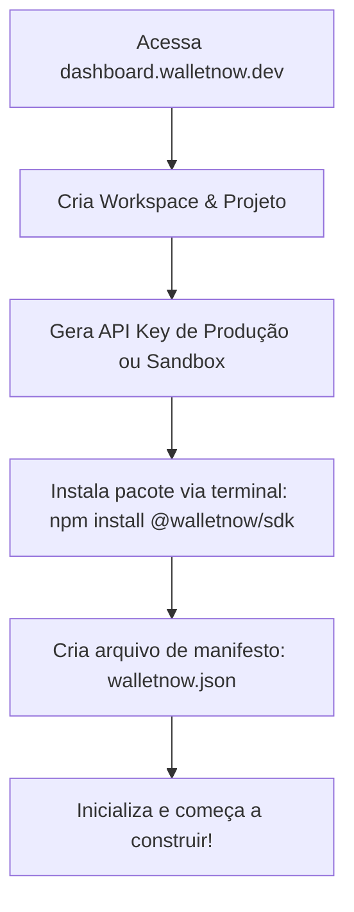

# Product Architecture Review v4.0: WalletNow como Infraestrutura da Stellar

O objetivo desta revisão é elevar o WalletNow de um framework de desenvolvimento a uma **plataforma completa de infraestrutura** (a "Vercel da Stellar" ou a "Stripe da Stellar"). A proposta central é que o desenvolvedor não deve gerenciar a complexidade interna de registries, engines ou comunicação direta com nós blockchain. Em vez disso, consome serviços simplificados de alto nível, enquanto a plataforma monetiza através de facilidades de nuvem, sponsorship de taxas (gas), telemetria e APIs de alta confiabilidade.

---

## 1. Quem são nossos usuários?

A plataforma WalletNow atende a quatro perfis principais de construtores no ecossistema de finanças descentralizadas e Web3:

```
┌─────────────────────────────────────────────────────────────────────────┐
│                           USUÁRIOS WALLETNOW                            │
├───────────────────┬───────────────────┬─────────────────┬───────────────┤
│    HACKATHONS     │     STARTUPS      │    FINTECHS     │  ENTERPRISES  │
│  & INDIE BUILDERS │     & WEB3 MVPS   │   & DEFI APPS   │  & WEB2 ORGS  │
└───────────────────┴───────────────────┴─────────────────┴───────────────┘
```

1. **Hackathons & Indie Builders**: 
   * *Necessidade*: Agilidade extrema. Querem lançar uma ideia em 24/48 horas.
   * *Foco*: Ferramentas prontas de Testnet, Faucets automatizados, templates de UI e boilerplates com o mínimo de fricção.
2. **Startups & Web3 MVPs**:
   * *Necessidade*: Foco no produto final. Não querem manter servidores RPC ou criar lógica complexa de assinatura XDR.
   * *Foco*: Login social simplificado, criação rápida de carteiras e estabilidade de conexão.
3. **Fintechs & DeFi Apps**:
   * *Necessidade*: Escalabilidade, custo previsível de transação e experiência do usuário (UX) otimizada para o público geral.
   * *Foco*: Gas Station (transações sem taxa para o usuário final - *gasless*), rotas otimizadas de swaps de liquidez, auditoria de transações.
4. **Enterprises & Web2 Corporates**:
   * *Necessidade*: Segurança, conformidade, alta disponibilidade e relatórios gerenciais/contábeis das operações de rede.
   * *Foco*: Workspaces corporativos, Multi-sig, Auditoria de logs, Webhooks garantidos e conformidade de regras fiscais/regulatórias.

---

## 2. A Trindade de Produtos e suas Responsabilidades

O ecossistema é dividido estritamente em três pilares, cada um com uma responsabilidade clara e escopo delimitado:

```
┌────────────────────────────────────────────────────────────────────────┐
│                          WALLETNOW ECOSYSTEM                           │
├────────────────────────┬──────────────────────┬────────────────────────┤
│     WALLETNOW OS       │    WALLETNOW SDK     │    WALLETNOW CLOUD     │
│        (Kernel)        │     (Biblioteca)     │    (Infraestrutura)    │
├────────────────────────┼──────────────────────┼────────────────────────┤
│ • Core Protocol Engine │ • Interfaces de Domínio│ • Cloud API Gateway   │
│ • Transaction Builder  │ • CLI Dev-Tool       │ • Dashboard & API Keys │
│ • Local Decoders & Sign│ • Leitura de Manifest │ • Gas Station & Relays │
│ • Extensible Adapters  │ • Zero-Setup Client  │ • Logs & Analytics     │
└────────────────────────┴──────────────────────┴────────────────────────┘
```

### A. WalletNow OS (Kernel)
* **O que é**: O motor de regras e protocolo de baixo nível. É agnóstico e independente de ambiente (roda tanto no browser quanto no backend).
* **Responsabilidade**: 
  * Construção e parsing de transações Soroban (XDR).
  * Lógica criptográfica local de assinatura de transações e derivamento de chaves locais.
  * Estruturas abstratas de comunicação de plugins e provedores (Horizon, RPC, Soroswap, Blend, Phoenix, Defindex).
  * É a engine que traduz comandos estruturados em transações Stellar válidas.

### B. WalletNow SDK (Biblioteca)
* **O que é**: O ponto de entrada público do desenvolvedor. A única dependência que ele adiciona via gerenciador de pacotes (`npm install @walletnow/sdk`).
* **Responsabilidade**:
  * Fornecer uma interface de programação limpa e sem "vazamentos de infraestrutura" (o builder não vê Registries, Storages ou Crypto drivers).
  * expor endpoints centrados em **Domínio** (e.g. `identity`, `wallet`, `swap`).
  * Ler o arquivo de configuração `walletnow.json` para auto-configurar o comportamento da aplicação.

### C. WalletNow Cloud (Infraestrutura SaaS)
* **O que é**: O núcleo de negócios e monetização da empresa. É a infraestrutura centralizada de serviços de nuvem baseada na Stellar.
* **Responsabilidade**:
  * Distribuição e autenticação de chaves de API (`API Keys`) vinculadas a projetos e workspaces.
  * Captura de logs de transações e geração de telemetria/métricas de uso (Analytics).
  * **Gas Station**: Gestão de contas patrocinadoras, assinaturas de transações patrocinadas e controle de taxas e limites.
  * **Webhooks & Alertas**: Envio de eventos em tempo real (ex: "depósito concluído") com garantia de entrega e retentativas automáticas.
  * APIs auxiliares: Caching de cotações de swap de múltiplos pools da Stellar, Testnet Faucet e geradores de liquidez.

---

## 3. Modelo de Distribuição: Open Source vs. SaaS

A estratégia de mercado se baseia em open-source como gerador de adoção e SaaS como gerador de receita.

### Open Source (Adoção & Confiança)
* **WalletNow Kernel (OS)**: Transparência total sobre como as transações são montadas e chaves locais são geridas. Garante que desenvolvedores não fiquem presos a um único vendor (sem *vendor lock-in*).
* **WalletNow SDK**: Aberto a contribuições da comunidade Stellar e auditorias públicas.
* **WalletNow CLI**: A ferramenta de automação e scaffolding local do desenvolvedor.

### SaaS (Receita & Valor de Tempo)
* **Console Dashboard**: Gerenciamento visual de workspaces, projetos, chaves de API e faturamento.
* **Cloud API Gateway**: Acesso a nós de alta disponibilidade da Stellar com proteção contra rate-limits.
* **Gas Station Service**: Cobrança baseada no volume de taxas patrocinadas processadas, com taxas de conveniência/conversão e planos empresariais de patrocínio.
* **Analytics Engine**: Métricas de atividade financeira, falhas de transação, usuários ativos na rede e volume movimentado por carteira.
* **Webhooks Gerenciados**: Garantia de entrega e infraestrutura de mensageria escalável para conectar a blockchain com servidores Web2 tradicionais.

---

## 4. A Jornada Sem Fricção do Builder

O fluxo de trabalho foi projetado para levar o desenvolvedor do cadastro à primeira transação Stellar em menos de 5 minutos:



1. **Setup**: O desenvolvedor acessa o dashboard e cria sua conta.
2. **Provisionamento**: Cria um workspace para a organização e um projeto associado a uma rede (ex: Testnet).
3. **Chaves**: Copia a API Key gerada e o código boilerplate sugerido no dashboard.
4. **Projeto**: Adiciona o SDK ao seu código-fonte e cria o arquivo de manifesto `walletnow.json`.
5. **Execução**: O builder inicia a aplicação. A partir deste ponto, o SDK lê as configurações locais, conecta-se à Cloud API e expõe as funções de domínio prontas para o consumo.

---

## 5. Arquitetura de Comunicação Unificada

Para permitir telemetria, otimização de custos de gas e recursos premium, o SDK não se comunica diretamente com a rede pública da Stellar. Ele passa de forma centralizada pelo gateway do WalletNow Cloud.

```
┌────────────────────────────────────────────────────────────┐
│                    Builder Client Code                     │
│               ex: wn.swap.execute(params)                  │
└─────────────────────────────┬──────────────────────────────┘
                              │ (Chamada de Domínio)
                              ▼
┌────────────────────────────────────────────────────────────┐
│                    WalletNow SDK (Client)                  │
│  - Lê walletnow.json                                       │
│  - Assina transações de forma não-custodial (se aplicável) │
└─────────────────────────────┬──────────────────────────────┘
                              │ (HTTPS/gRPC seguro com API Key)
                              ▼
┌────────────────────────────────────────────────────────────┐
│                 WalletNow Cloud API Gateway                 │
│  - Verifica API Keys & Workspaces                          │
│  - Envia dados para o Analytics                            │
│  - Patrocina taxas (Gas Station)                           │
│  - Otimiza e valida XDR                                    │
└─────────────────────────────┬──────────────────────────────┘
                              │ (Executa Engine do Kernel)
                              ▼
┌────────────────────────────────────────────────────────────┐
│                  WalletNow OS (Cloud Kernel)               │
│  - Montagem/Decodificação de transações Stellar/Soroban    │
│  - Integração com provedores externos cadastrados          │
└─────────────────────────────┬──────────────────────────────┘
                              │ (Horizon / Soroban RPC)
                              ▼
┌────────────────────────────────────────────────────────────┐
│                       Stellar Network                      │
└────────────────────────────────────────────────────────────┘
```

> [!NOTE]
> Para fluxos totalmente descentralizados ou locais, a arquitetura permite configurar o SDK para apontar diretamente para um nó público Stellar (ignorando o Cloud API Gateway), mas com perda imediata das funcionalidades SaaS (Analytics, Gas Station nativo, Webhooks gerenciados).

---

## 6. O WalletNow Manifest (`walletnow.json`)

O arquivo `walletnow.json` é a peça central que remove a necessidade de códigos complexos de infraestrutura. Ele define o comportamento da aplicação em um formato declarativo simples que pode se tornar um padrão de ecossistema para DApps na Stellar.

```json
{
  "name": "Super DApp",
  "network": "testnet",
  "identity": {
    "providers": ["social", "passkey"]
  },
  "wallet": {
    "type": "non-custodial",
    "backup": "cloud"
  },
  "payments": {
    "gasless": true,
    "allowedTokens": ["USDC", "XLM"]
  },
  "swap": {
    "preferredProviders": ["soroswap", "phoenix"]
  }
}
```

### O impacto do Manifesto:
* **Zero Boilerplate**: O desenvolvedor não precisa escrever código para instanciar repositórios, injetar chaves de provedores ou configurar endpoints de nós.
* **Auto-Injeção**: Com base no manifesto, o SDK autoconfigura os adaptadores internos de comunicação e de experiência do usuário.
* **Portabilidade**: Mudar de ambiente (Testnet para Mainnet) ou de provedores DeFi preferidos requer apenas a alteração de um campo no arquivo JSON.

---

## 7. SDK Minimalista Orientado a Domínio

O desenvolvedor não precisa conhecer termos complexos como `Engine`, `Registry`, `Adapter`, `Storage` ou `Crypto`. Toda essa estrutura complexa de software é movida para a camada interna e privada. A API exposta reflete exclusivamente as necessidades de negócios do produto:

```typescript
import { WalletNow } from "@walletnow/sdk";

// Inicialização limpa e automática (configurações lidas do walletnow.json)
const wn = await WalletNow.init({
  apiKey: process.env.WALLETNOW_API_KEY
});

// 1. Identity: Autenticação simplificada
const user = await wn.identity.login({ provider: "social" });

// 2. Wallet: Manipulação de carteiras
const newWallet = await wn.wallet.create();
await wn.wallet.connect(user);

// 3. Payments: Transferência de fundos com suporte nativo a Gasless
const tx = await wn.payments.send({
  to: "GB...",
  amount: "50",
  token: "USDC",
  gasless: true // Resolvido dinamicamente via Gas Station da Cloud
});

// 4. Swap: Troca de tokens multi-provedor (Soroswap, Phoenix...)
const quote = await wn.swap.quote({ from: "XLM", to: "USDC", amount: "100" });
const swapReceipt = await wn.swap.execute(quote);

// 5. Yield: Interação com DeFi Lending (Blend, Defindex...)
const yieldPosition = await wn.yield.deposit({
  provider: "blend",
  token: "USDC",
  amount: "1000"
});

// 6. Testnet Kit: Auxiliares de desenvolvimento
if (wn.isTestnet()) {
  await wn.testnet.faucet({ address: newWallet.address, token: "USDC" });
  await wn.testnet.seedLiquidity({ pool: "USDC/XLM", amount: "50000" });
}
```

---

## 8. Distribuição de Funcionalidades por Camada

Abaixo está o mapeamento de onde cada funcionalidade e serviço da plataforma é implementado e executado:

| Funcionalidade | Localização Primária | Responsabilidade |
| :--- | :--- | :--- |
| **API Keys & Workspaces** | Plataforma / Cloud | Controle de acesso a projetos e isolamento de dados de faturamento. |
| **Analytics & Telemetria** | Plataforma / Cloud | Coleta assíncrona de dados de tráfego, erros, performance e volume financeiro. |
| **Gas Station** | Plataforma / Cloud | Orquestração de carteiras de patrocínio, controle de limites e assinatura de XDRs com Fee Sponsorship. |
| **Testnet Kit & Seeder** | Plataforma / Cloud | Serviços para mintar tokens fictícios e injetar liquidez simulada em contratos inteligentes da rede de testes. |
| **Marketplace de Provedores**| Plataforma / Cloud | Ativação ou desativação (via clique no dashboard) de provedores de liquidez no pipeline de execução da API. |
| **Criptografia & Assinatura**| SDK (Cliente) | Garante que as chaves privadas geradas localmente nunca sejam transmitidas ao Cloud (não-custodial). |
| **Montagem de XDR** | WalletNow OS (Kernel) | Construção binária de transações e validação local antes do envio para a Cloud. |
| **Billing & Faturamento** | Plataforma / Cloud | Cobrança por uso de endpoints de API, notificações webhooks e sponsorship de taxas. |

---

## 9. Proposta de Arquitetura Definitiva (Product Architecture v4.0)

A arquitetura final do ecossistema estrutura-se em quatro níveis verticais de responsabilidade. Cada camada expõe interfaces rígidas para a camada superior, minimizando dependências circulares e otimizando a modularização.

```
                     ┌──────────────────────────────────────┐
                     │            CONSUMER LAYER            │
                     │  - Builders, DApps, Fintechs, Web2   │
                     └──────────────────┬───────────────────┘
                                        │
                                        ▼
                     ┌──────────────────────────────────────┐
                     │        PRODUCT & INTERFACE LAYER     │
                     │  - Developer Console Dashboard (Web) │
                     │  - JS/TS SDK Client                  │
                     │  - WalletNow CLI / Scaffolder        │
                     │  - Manifest (walletnow.json)         │
                     └──────────────────┬───────────────────┘
                                        │
                                        ▼
 ┌──────────────────────────────────────┴──────────────────────────────────────┐
 │                            PLATFORM & API SERVICES                          │
 │  - API Key & Workspace Gateway  - Webhook Dispatcher  - Caching & Quotes    │
 │  - Gas Station (Sponsorship)    - Billing & Plans     - Analytics Collector │
 └──────────────────────────────────────┬──────────────────────────────────────┘
                                        │
                                        ▼
 ┌──────────────────────────────────────┴──────────────────────────────────────┐
 │                             CORE KERNEL & ENGINES                           │
 │  - WalletNow OS (Core Protocol) - State Manager       - Storage Adapters    │
 │  - Transaction Assembly/Parsing  - Crypto Driver       - Dev Testing Fakes   │
 └──────────────────────────────────────┬──────────────────────────────────────┘
                                        │
                                        ▼
 ┌──────────────────────────────────────┴──────────────────────────────────────┐
 │                                INTEGRATIONS                                 │
 │  - Stellar Core / Horizon RPC   - DEXs (Soroswap, Phoenix)                  │
 │  - Lending Protocols (Blend)    - Liquidity Engines (Defindex)              │
 └─────────────────────────────────────────────────────────────────────────────┘
```

### O que esta Arquitetura v4.0 muda na Prática?
1. **Evita Overengineering no Início**: O SDK não expõe a infraestrutura interna do kernel. O desenvolvedor interage com uma API Web2-like.
2. **Garante Monetização Sustentável**: A plataforma centraliza serviços vitais que exigem back-end confiável (Sponsorship, Analytics, Webhooks, Caching) e que são difíceis de rodar diretamente do front-end sem infraestrutura auxiliar.
3. **Escala a Adoção com o Manifest**: O arquivo `walletnow.json` remove a necessidade de aprendizado e configuração profunda sobre nós blockchain, facilitando a adoção por builders tradicionais do ecossistema Web2.
4. **Isolamento de Segurança**: A lógica de criptografia de chaves privadas continua sendo executada no cliente (via SDK/OS Kernel local), preservando o caráter não-custodial exigido por aplicações Web3, enquanto o tráfego de transações se beneficia da robustez da infraestrutura Cloud.
