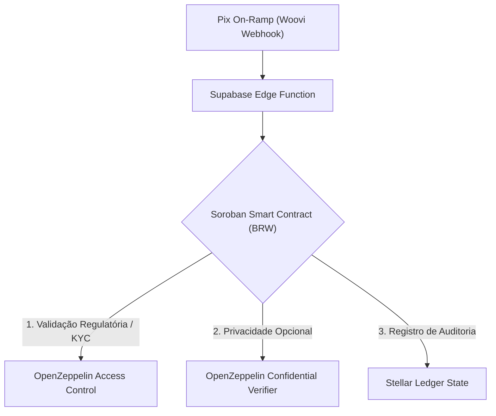

# Plano de Adequações e Evolução: Ecossistema Stellar, SEPs e Soroban

Este documento apresenta uma avaliação técnica abrangente e um plano de implementação para elevar o **WalletNow Protocol** a nível de prontidão para produção e conformidade estrita com os padrões oficiais do ecossistema **Stellar**.

---

## 1. Avaliação da Infraestrutura Atual e Gaps de Produção

A arquitetura atual do WalletNow resolve de forma exemplar a fricção de entrada na Web3 (onboarding biométrico via Passkeys + patrocínio de taxas via CAP-33 + rampas instantâneas via Pix/Woovi). Contudo, para se consolidar como um ecossistema interoperável, seguro e regulatório na rede Stellar, identificamos os seguintes gaps técnicos:

* **Sessão Centralizada vs. Autenticação On-chain**: O gerenciamento de tokens de sessão no desenvolvedor portal e aplicação é feito através de validação tradicional de JWT/API keys no Supabase. O ecossistema Stellar exige o padrão **SEP-10** para provar a posse de chaves criptográficas.
* **Isolamento de Custódia e Assinaturas (Relayer)**: As operações patrocinadas (Mint de BRW/USDW) dependem de uma Edge Function central que detém a `STELLAR_SPONSOR_SECRET`. Esse modelo cria um ponto único de falha e vetor de drenagem de liquidez se as chaves forem expostas.
* **Ausência de Metadados de Ativos (SEP-01)**: Os tokens BRW e USDW circulam na rede de teste sem metadados públicos, impossibilitando wallets de mercado (ex: L積極, Vibrant, Albedo) de identificá-los como ativos regulados legítimos e de expor as rotas de depósito/saque.

---

## 2. Adequação aos Padrões Nativos da Stellar (SEPs)

Para garantir interoperabilidade global com a rede Stellar, o protocolo WalletNow deve implementar nativamente as seguintes Propostas de Ecossistema Stellar (SEPs):

### 📋 SEP-01: Configuração do Arquivo `stellar.toml`
Todo emissor e âncora na rede Stellar deve publicar um arquivo `stellar.toml` sob o domínio HTTPS oficial (ex: `https://walletnow.app/.well-known/stellar.toml`).
* **Finalidade**: Declarar a identidade das contas emissoras de `BRW` e `USDW`, URLs de endpoints de APIs, chaves públicas dos validadores, e os metadados dos tokens (imagem, nome completo, descrição).
* **Campos Obrigatórios**:
  ```toml
  # stellar.toml
  ACCOUNTS = ["G_ISSUER_PUBLIC_KEY"]
  VERSION = "2.1.0"

  [[CURRENCIES]]
  code = "BRW"
  issuer = "G_ISSUER_PUBLIC_KEY"
  display_decimals = 2
  name = "WalletNow BRL stablecoin"
  desc = "Stablecoin colateralizada em Real vinculada a rampas Pix."
  conditions = "Strict 1:1 BRL reserve check via Woovi conciliation."

  [[CURRENCIES]]
  code = "USDW"
  issuer = "G_ISSUER_PUBLIC_KEY"
  display_decimals = 2
  name = "WalletNow USD stablecoin"

  [DOCUMENTATION]
  ORG_NAME = "WalletNow Protocol"
  ORG_URL = "https://walletnow.app"
  ```

### 🔐 SEP-10: Stellar Web Authentication (Auth Challenge-Response)
Substituir o login centralizado tradicional de API Keys por autenticação criptográfica on-chain sem senha.
1. **O Desafio**: O cliente requisita um desafio de login à Edge Function da WalletNow.
2. **O XDR do Desafio**: A Edge Function monta uma transação Stellar contendo operações inválidas (usando timeouts e contas dummy) assinada pela chave da WalletNow.
3. **Assinatura do Cliente**: O cliente recebe o XDR, valida o conteúdo no dispositivo (`DeviceVault` ou chave de Passkey) e assina a transação localmente com sua chave privada.
4. **Validação**: O cliente envia a transação assinada de volta. O servidor valida se a assinatura pertence ao dono do endereço público e gera um token de sessão JWT de curta duração.

### 💳 SEP-24 / SEP-38: Plataforma de Âncora (Anchor Platform)
Padronizar a rampa de Pix e moedas internacionais seguindo as APIs padrões de âncoras.
* **SEP-24 (Hosted Deposits/Withdrawals)**: Expõe interfaces web universais para que carteiras Stellar de terceiros abram o fluxo de depósito (Pix In) ou saque (Pix Out) da WalletNow dentro de seus aplicativos.
* **SEP-38 (Anchor Quotes)**: Permite que outras aplicações consultem a cotação de mercado para conversões fiat-to-stablecoin e stablecoin-to-stablecoin na WalletNow de maneira programática antes de fechar a transação.

---

## 3. Contratos Inteligentes Soroban & Integração OpenZeppelin

A transição dos tokens BRW/USDW de contas clássicas da Stellar para **Soroban Smart Contracts (WASM)** e a adoção dos padrões OpenZeppelin trazem flexibilidade e conformidade a nível regulatório.



### 🛡️ 1. Contrato Inteligente de Ativo Regulado (Token Soroban)
Utilizar a especificação do SDK do Soroban para implementar o contrato de Token, estendendo-o com módulos de conformidade regulatória:
* **Access Control (Padrão OpenZeppelin)**: Papéis estruturados para administradores (`Owner`, `Minter`, `Clawback`).
* **Clawback (Recuperação)**: Implementar a habilidade nativa da Stellar de recuperar ativos em caso de fraude, perda de chaves de passkeys ou ordens judiciais.
* **Freeze (Congelamento)**: Bloquear temporariamente contas em investigação sem interromper o fluxo global do token.

### 🕵️ 2. Privacidade e Transações Confidenciais (OpenZeppelin + ZK-SNARKs)
Integrar a biblioteca **OpenZeppelin Confidential Verifier (Soroban)** baseada em provas de conhecimento zero (como UltraHonk ZK-SNARKs):
* **O Problema**: A Stellar possui ledger transparente, o que expõe saldos e transações Pix de grandes empresas, violando leis de privacidade de dados (como LGPD/GDPR).
* **A Solução**: O contrato confidencial do token Soroban substitui os saldos em texto aberto por **compromissos criptográficos** (Pedersen Commitments).
* **Verificação na Blockchain**: Para transferir tokens confidenciais, o cliente gera uma prova criptográfica local (ZK-proof) demonstrando que possui saldo suficiente e que a soma dos valores de saída é igual à de entrada, sem revelar os valores reais. O contrato inteligente verifica a ZK-proof utilizando funções matemáticas nativas do Soroban para garantir que a transação é válida.

### 📈 3. DeFi Automatizado com DEX e Yields Nativos
* **AMM Pools Permanentes**: Substituir swaps em JavaScript locais por interações diretas com protocolos como **Soroswap** e **Defindex** na Testnet/Mainnet.
* **Auto-Yield (Geração de Rendimento)**: Criar sub-contas em contratos inteligentes de cofres (Yield Vaults) onde frações do BRW de tesouraria do usuário são aplicadas automaticamente em RWA tokenizados (como títulos do Tesouro Direto representados on-chain via Etherfuse), creditando juros diários direto na carteira do usuário.

---

## 4. Auditoria de Segurança e Gerenciamento Seguro de Chaves

A segurança em ambientes híbridos (Client-side Self-custody + Edge Functions Backend) exige defesas ativas contra invasões e erros operacionais:

### 🔑 1. Gerenciamento Seguro de Segredos no Servidor (Sponsor Key)
Em vez de salvar a chave privada do patrocinador (`STELLAR_SPONSOR_SECRET`) no arquivo de configuração do Supabase:
* **Integração HSM/KMS**: Utilizar serviços de gerenciamento de chaves na nuvem, como **AWS KMS** ou **Google Cloud KMS**, onde a chave privada fica restrita a chips de hardware dedicados (FIPS 140-2 Level 3). As requisições de assinatura ocorrem dentro da sandbox da AWS/GCP, impedindo que a chave secreta vaze mesmo em caso de invasão de código.
* **Multi-Signature (Multi-sig) da Stellar**: Dividir a assinatura de transações de tesouraria de grande porte. Por exemplo, operações que excedam R$ 50.000,00 precisam da assinatura de duas chaves independentes (a chave automática da Edge Function + uma chave offline de segurança guardada em dispositivo físico Ledger).

### 🖥️ 2. DeviceVault Criptografado no Client
Fortalecer a segurança local no navegador para chaves importadas (Legacy Account Mode):
* **Derivação de Chave baseada em Senha (PBKDF2)**: A frase semente de 12 palavras do usuário nunca deve ser guardada em texto plano no `localStorage`.
* **Criptografia Simétrica Avançada**: Utilizar as Web Crypto APIs nativas do navegador para derivar uma chave forte a partir de PBKDF2 e criptografar a semente localmente em **AES-256-GCM** com vetor de inicialização dinâmico (IV).
* **Passkey WebAuthn Protection**: A assinatura biométrica do dispositivo pode ser usada como entropia adicional na criptografia, garantindo que o cofre de chaves só seja descriptografado se a biometria do usuário (FaceID/TouchID) for validada no hardware de segurança (Enclave).

---

## 5. Roteiro de Implementação Incremental (Fases)

```
                       ROTEIRO DE DESENVOLVIMENTO
┌──────────────────────┐   ┌──────────────────────┐   ┌──────────────────────┐
│ FASE 1: CONFORMIDADE │ ─►│ FASE 2: CONTRATOS    │ ─►│ FASE 3: PRIVACIDADE │
│ SEP-01, 10 & 24      │   │ Soroban ERC-20 & AMM │   │ ZK Confidential Token│
└──────────────────────┘   └──────────────────────┘   └──────────────────────┘
```

### Fase 1: Conformidade Criptográfica (Prazo: 4 semanas)
* Criar e disponibilizar o arquivo `stellar.toml` (SEP-01) com as especificações dos ativos BRW e USDW.
* Implementar o fluxo de autenticação challenge-response do SEP-10 nas Supabase Edge Functions.
* Configurar o servidor para responder ao protocolo de depósito e saques externos da SEP-24.

### Fase 2: Programação Inteligente com Soroban (Prazo: 6 semanas)
* Portar a stablecoin BRW clássica para o padrão de Token Soroban WASM.
* Codificar regras de clawback e controle de acesso baseado em cargos para auditoria governamental.
* Conectar o Swap da interface diretamente a contratos reais de pools AMM Soroswap na Testnet.

### Fase 3: Privacidade Híbrida e Escala (Prazo: 8 semanas)
* Integrar as bibliotecas do OpenZeppelin Confidential Verifier no contrato Soroban.
* Criar o gerador de ZK-proofs em Javascript rodando no cliente via WebAssembly para assinar transações confidenciais sem expor os valores.
* Implementar o AWS KMS para blindagem de chaves de patrocínio no backend.
